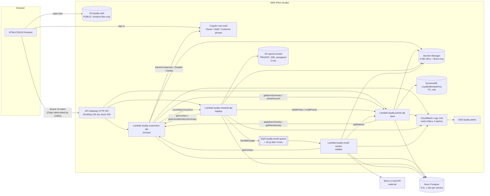

# Architecture (report sections 1-2, plus the service list for section 3)

## Problem definition

Small businesses (cafes, salons, shops) run loyalty schemes on paper stamp cards or
spreadsheets: cards get lost or faked, staff can give points to friends, nobody knows which
customers stopped coming, and there is no record of who changed what. LoyaltyHub replaces that
with a secure cloud system: staff register customers and add points at the counter, customers
sign in to see their points and redeem rewards, and the owner controls the earn rate, rewards and
reports.

| Users / roles | Benefit |
|---|---|
| Owner | controls earn rate and rewards, sees dashboard, reports and suspicious staff activity |
| Staff | registers customers, adds points, hands over rewards with a voucher check |
| Customer | sees balance, tier and history, redeems rewards, gets voucher e-mails |

**In scope**: points earning with tiers, rewards with stock, vouchers, reports, audit logs, multi-
business isolation, deployment on Floci with Neon. **Out of scope**: card payments, POS
integration, mobile apps, SMS, marketing campaigns, self sign-up (staff register customers).

## Diagram

## Components

| Component | What it does | Owner |
|---|---|---|
| Frontend (`frontend/`) | Plain HTML/CSS/JS modules, hosted in the public S3 website bucket. Strict CSP (no inline script/style). | all three, one file each |
| Cognito | Sign-in for every role. E-mail is the username. Groups `Owner`, `Staff`, `Customer`. Custom attributes `business_id`, `customer_id`. Customers created by staff must change their temporary password at first sign-in. | Jomana |
| API Gateway (HTTP API) | Only the routes in `infra/scripts/06-api-gateway.sh` exist; everything else is 404 before our code runs. Stage throttling. | Jana |
| Customers & Membership Lambda | Registration (DB + Cognito login, with compensation), search, status workflow (suspend/reactivate, disables the login), **tier engine** (Bronze/Silver/Gold from the last 12 months of points, upgrade at once, downgrade one level after 30-day grace), engagement segments, GDPR-style erasure workflow, active-members report. | Jomana |
| Points & Transactions Lambda | Earn with **idempotency** (DynamoDB + unique DB index), earn rules and limits, tier multiplier from Customers, append-only ledger, voids and adjustments (owner, with reasons), staff-activity abuse report. | Jana |
| Rewards & Redemption Lambda | Catalogue with stock and monthly limits, **redemption saga** (reserve stock, debit Points, issue voucher, refund on failure), voucher fulfil/cancel workflow, CSV report to private S3, owner dashboard combining all three services. | Habiba |
| E-mail worker Lambda | Reads SQS, gathers contact (Customers) and balance (Points), sends the voucher e-mail through **Brevo** (the real external API). Failed messages retry 3 times, then go to the DLQ. | Habiba |
| Neon Postgres | One database, one schema, but each service connects with its own Postgres role that can only touch its own tables. TLS required. | Jana (roles), each owner their tables |
| Secrets Manager | `loyalty/<service>/database-url` per service and `loyalty/brevo-api-key`. Each Lambda's IAM policy can read only its own secret. | Habiba |
| CloudWatch + SNS | Structured JSON logs (passwords/tokens redacted, e-mails masked), 14-day retention, metric filters and alarms. | Jana (metric filters, alarms), Habiba (logger), each owner their events |

## How the services talk to each other

Services never read another service's tables. They call each other with `lambda:Invoke`
(`backend/shared/service-client.js`) using an internal event
`{ source: "loyalty.internal", caller, action, payload }`. Two checks protect it:

1. **IAM**: only the Lambda roles listed in `infra/iam/*-policy.json` may invoke a function
   (e.g. Points may invoke Customers, but not Rewards).
2. **Code**: each internal action lists `allowedCallers` (e.g. only `rewards` may call
   `debitPoints`). A wrong caller gets 403 and a `SECURITY INTERNAL_CALLER_DENIED` log.

API Gateway events always carry `requestContext.http`, so an HTTP request can never be
treated as an internal call.

| Call | Why |
|---|---|
| Points -> Customers `getMembership`, `applyEarnActivity` | tier multiplier for earning; status check; tier re-evaluation after earning |
| Customers -> Points `getEarnSummary`, `closeAccount` | 12-month points for the tier engine; close the account at erasure |
| Customers -> Rewards `countOpenVouchers` | erasure is refused while vouchers are open |
| Rewards -> Points `debitPoints`, `creditPoints`, `getPointsSummary` | redemption saga and refunds; dashboard |
| Rewards -> Customers `getMembership`, `getContact`, `getActiveMembersSummary` | redeem only for active members; dashboard |
| E-mail worker -> Customers / Points | name + e-mail and the new balance for the voucher e-mail |

## AWS services per student (requirement: at least 3 each)

| Student | Service built | AWS services they own and configure |
|---|---|---|
| Habiba | Rewards & Redemption | S3 (public website bucket + private reports bucket), SQS + DLQ, Secrets Manager, Lambda (API + e-mail worker), IAM policies for Rewards and the worker |
| Jomana | Customers & Membership | Cognito (pool, groups, client, admin user lifecycle from her Lambda), Lambda, IAM role/policy for Customers (Cognito admin actions on our pool only) |
| Jana | Points & Transactions | DynamoDB (idempotency, TTL), API Gateway (routes, throttling), CloudWatch (retention, metric filters, alarms) + SNS, Lambda, IAM role/policy for Points; Neon roles and grants |

## Scaling to 10,000+ users

- Lambda scales per request; API Gateway throttling stops floods before they reach Neon.
- Neon serverless driver over HTTPS (no connection pool exhaustion from many Lambdas).
- Indexes for every search and report (`database/002-004`), including trigram search on names.
- Pagination is mandatory (max 100 per page).
- `npm run db:seed10k` loads 10,000 customers and about 50,000 ledger rows;
  `tests/load/load-test.mjs` drives the deployed API with many parallel counters (results in `docs/security-tests.md`).
