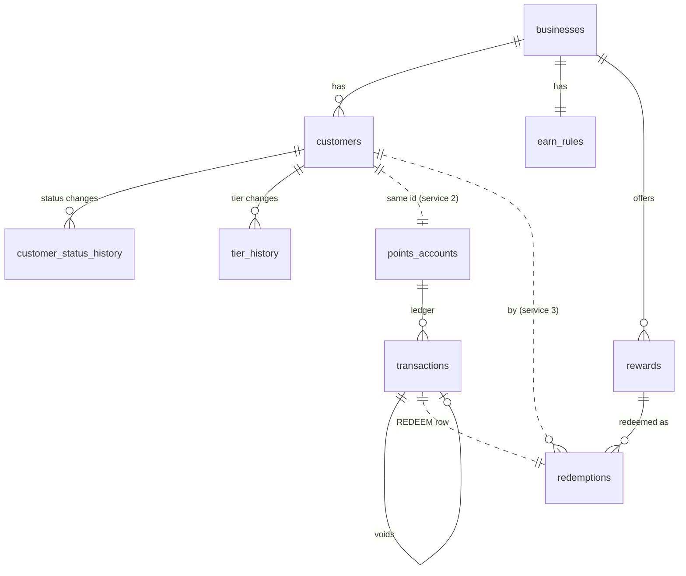

# Data model (report section 7)

One Neon Postgres database. Each service owns its tables and connects with its own role
(`database/005_app_role_grants.sql`), so it cannot read or change the other services' tables.
Cross-service ids (e.g. `redemptions.customer_id`) are plain uuids without foreign keys, because
the other service owns that row; the services keep them consistent through internal calls.

| Table | Owner (role) | Key rules |
|---|---|---|
| businesses | foundation (read by all) | tenant; every query filters by `business_id` |
| customers | Customers (`loyalty_customers_svc`) | unique e-mail per business (case-insensitive); status `active/suspended/erased`; tier `BRONZE/SILVER/GOLD`; e-mail/phone NULL after erasure; trigram index for name search |
| customer_status_history, tier_history | Customers | audit trail (who, when, why) |
| earn_rules | Points (`loyalty_points_svc`) | rate 0.01-100, max purchase, daily cap |
| points_accounts | Points | `balance >= 0` CHECK: a race can never make it negative |
| transactions | Points | **append-only** (trigger + no UPDATE/DELETE grant); unique `(business_id, idempotency_key)`; a transaction can be voided once; a redemption debited once and refunded once |
| rewards | Rewards (`loyalty_rewards_svc`) | `stock >= 0` CHECK; unique active name per business |
| redemptions | Rewards | unique voucher code; status `ISSUED/FULFILLED/CANCELLED`; e-mail status |

DynamoDB `LoyaltyIdempotency` (Points): `pk = businessId#Idempotency-Key`, request fingerprint,
stored response, `expiresAt` TTL 24 h.

Migrations: `database/001-005*.sql`, applied in order by `npm run db:migrate` and recorded in
`schema_migrations`. Seeds: `seed.sql` (2 demo businesses, earn rules, 4 rewards) and
`seed-10k.js` (10,000 customers, about 50,000 ledger rows).
